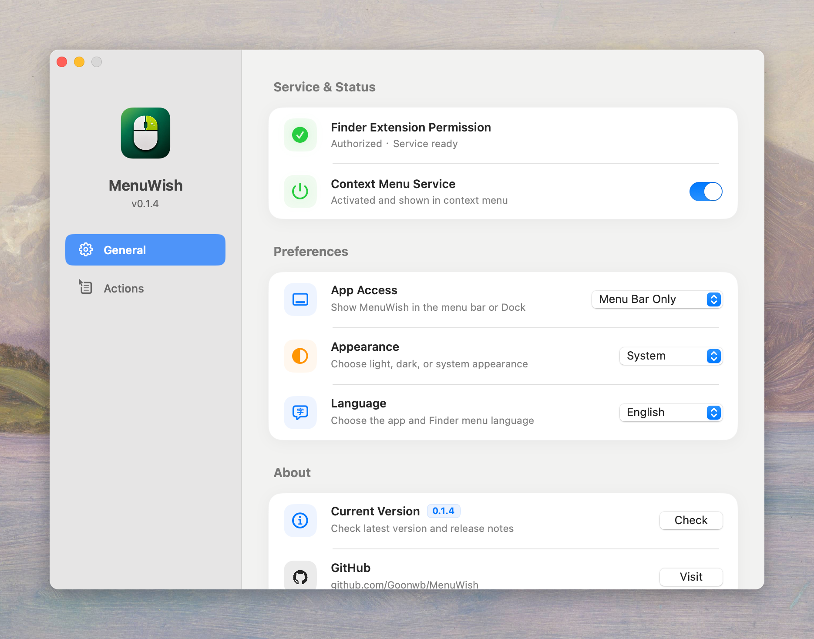
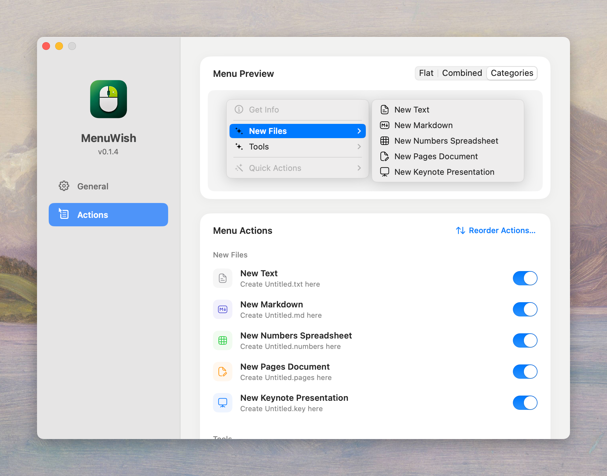

<p align="center">
  
</p>

<h1 align="center">MenuWish</h1>

<p align="center">
  <strong>Make your Finder right-click as you wish.</strong>
</p>

<p align="center">
  A lightweight, open-source Finder extension for creating files, opening Terminal, and copying paths.
</p>

<p align="center">
  <a href="README.md">中文</a> · English
</p>

<p align="center">
  <a href="LICENSE">MIT License</a>
  ·
  <a href="https://github.com/Goonwb">Author</a>
</p>

## Features

Native Finder Sync shortcuts for everyday tasks:

- **Create files**: Text, Markdown, Numbers, Pages, Keynote, Word, Excel, and PowerPoint. Duplicate names are numbered without overwriting existing files.
- **Open Terminal** at the current Finder location.
- **Copy paths** of selected items, or the current folder when nothing is selected.

Make the menu your own:

- **Switches**: enable the whole menu or individual actions.
- **Layouts**: Flat, Combined in one MenuWish submenu, or Categories for New Files and Tools. Empty categories are hidden.
- **Ordering**: reorder actions and drag category headers. Categories collapse during dragging and expand afterward.
- **Preview**: click to switch categories. Finder and previews use monochrome icons; settings retain color.
- **Updates**: check GitHub Releases, read release notes, and download updates in the app; once ready, quit and open the DMG installer.
- **Preferences**: Chinese or English, light or dark appearance, with system options; show the app in the menu bar (default), Dock, or both.

## Screenshots

<p align="center">
  
</p>

<p align="center">
  
</p>

## Requirements

- macOS 13.0 or later
- Xcode 15 or later for building from source

## Installer

Download and open the `.dmg` from [GitHub Releases](https://github.com/Goonwb/MenuWish/releases), drag **MenuWish** into **Applications**, then launch it.

Run `./Scripts/package.sh` to create `dist/MenuWish-<version>.dmg` and a ZIP fallback. Packaging requires Python 3.9 or later; the first run downloads pinned build dependencies into `build/package-venv`.

## Install From Source

```zsh
chmod +x Scripts/install-local.sh
./Scripts/install-local.sh
```

The script builds the Release app, copies it to `/Applications`, registers the Finder extension, and restarts Finder.

## Build Manually

The Xcode project and app target are named MenuWish. Bundle IDs, the shared preferences domain, and the internal URL scheme retain their original identifiers for compatibility with existing installations and settings.

```zsh
xcodebuild \
  -project MenuWish.xcodeproj \
  -scheme MenuWish \
  -configuration Release \
  -derivedDataPath build \
  build

open build/Build/Products/Release/MenuWish.app
```

## First-Time Permission

Open MenuWish, click **Authorize**, and enable **MenuWish** in the **File Provider** extension sheet.

Action switches are unavailable until authorized, then restore default or saved settings.

## Notes

- Current version: `0.1.6`.
- Creating iWork files does not launch the corresponding app; opening and editing requires Numbers, Pages, or Keynote. Templates were created with version 26.3.1; compatibility with older iWork versions is not yet verified.
- Word, Excel, and PowerPoint files use `.docx`, `.xlsx`, and `.pptx`, respectively, and can be opened with Microsoft Office or WPS.
- Office files are created from bundled blank templates without installing or launching an office app. Word starts with one blank page, Excel with one empty worksheet, and PowerPoint with one blank 16:9 slide. Double-clicking opens the file in the system's default app.
- The distributed app is not notarized yet. Users may need to allow it manually in macOS security settings.

## License

MenuWish is released under the [MIT License](LICENSE).

Action icons use the MIT-licensed [Hugeicons Stroke Rounded](https://github.com/hugeicons/hugeicons) set, including the new Word, Excel, and PowerPoint file icons. Markdown uses a matching custom icon. See [icon sources and attribution](Shared/MenuIcons/README.md).
