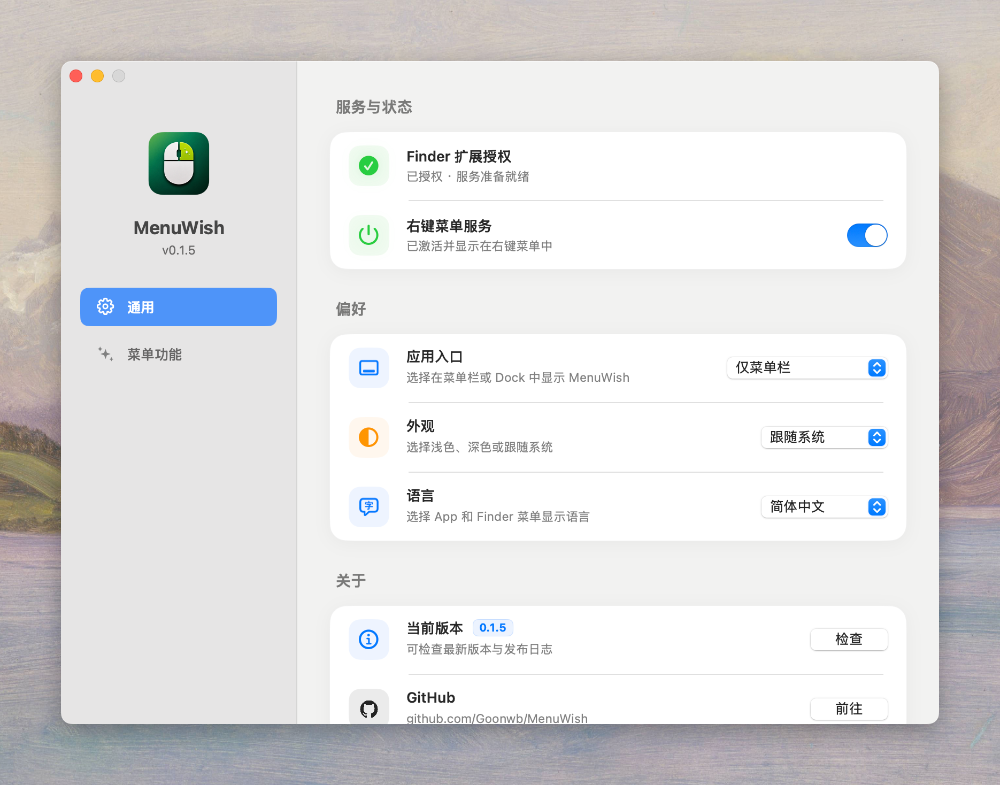
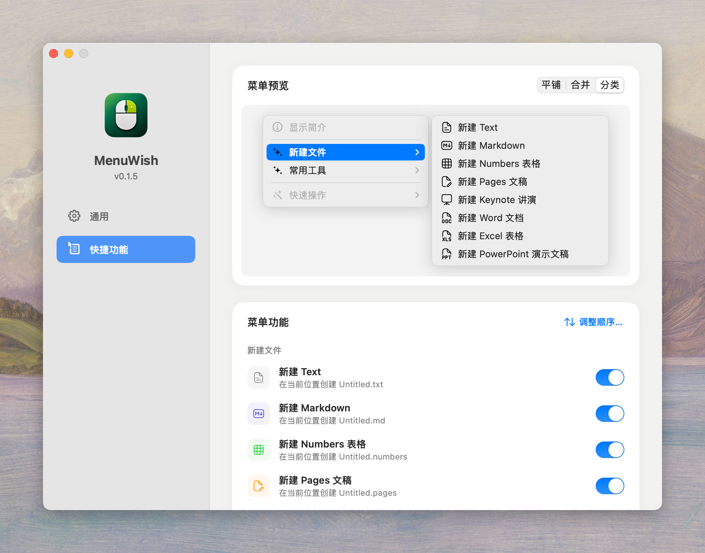

<p align="center">
  
</p>

<h1 align="center">MenuWish</h1>

<p align="center">
  <strong>让 Finder 右键菜单，随你所愿。</strong>
</p>

<p align="center">
  轻量开源的 Finder 菜单增强工具：新建文件、进入终端、拷贝路径。
</p>

<p align="center">
  中文 · <a href="README.en.md">English</a>
</p>

<p align="center">
  <a href="LICENSE">MIT License</a>
  ·
  <a href="https://github.com/Goonwb">作者</a>
</p>

## 功能

通过原生 Finder Sync 扩展，为右键菜单添加常用操作：

- **新建文件**：文本、Markdown、Numbers 表格、Pages 文稿、Keynote 讲演。重名自动编号，不覆盖已有文件。
- **进入终端**：在当前 Finder 位置打开 Terminal。
- **拷贝路径**：复制所选项目路径；未选择项目时复制当前文件夹路径。

可按习惯配置：

- **开关**：整体启停，或单独启用各项功能。
- **布局**：平铺、合并为 MenuWish 子菜单，或按「新建文件」「常用工具」分类；空类目自动隐藏。
- **排序**：调整功能顺序，拖动标题调整类目顺序；拖动时折叠，结束后展开。
- **预览**：点击切换类目；与 Finder 统一使用单色图标，设置列表保留彩色。
- **更新**：手动检查 GitHub Releases 更新，在应用内查看发布日志。
- **偏好**：中文或英文、浅色或深色，均可跟随系统；应用入口可选仅菜单栏（默认）、仅 Dock 或两者。

## 界面预览

### 通用设置

<p align="center">
  
</p>

### 快捷功能与分类预览

<p align="center">
  
</p>

## 系统要求

- macOS 13.0 或更高版本
- 如需从源码编译，需要 Xcode 15 或更高版本

## 安装包

从 [GitHub Releases](https://github.com/Goonwb/MenuWish/releases) 下载并打开 `.dmg`，将 **MenuWish** 拖入 **Applications（应用程序）** 后启动。

源码中运行 `./Scripts/package.sh` 可生成 `dist/MenuWish-<版本>.dmg` 和 ZIP 备用包。首次打包需要联网；脚本会在 `build/package-venv` 中安装固定版本的打包依赖，需要 Python 3.9 或更高版本。

## 从源码安装

```zsh
chmod +x Scripts/install-local.sh
./Scripts/install-local.sh
```

脚本会编译 Release 版本，将 App 复制到 `/Applications`，注册 Finder 扩展并重启 Finder。

## 手动编译

```zsh
xcodebuild \
  -project RightMenuMini.xcodeproj \
  -scheme RightMenuMini \
  -configuration Release \
  -derivedDataPath build \
  build

open build/Build/Products/Release/RightMenuMini.app
```

## 首次授权

打开 MenuWish，点击 **初次授权**，在 **文件提供程序** 扩展弹窗中启用 **MenuWish**。

授权前功能开关不可用；授权后恢复默认或已保存的设置。

## 说明

- 当前版本：`0.1.4`。
- iWork 文件使用内置原生模板创建，无需启动对应应用；打开和编辑需要对应应用。模板由 26.3.1 创建，旧版兼容性未验证。
- 当前分发版本尚未公证。其他用户安装时，可能需要在 macOS 安全设置中手动允许打开。

## 许可证

MenuWish 基于 [MIT License](LICENSE) 开源。

功能图标采用 MIT 许可的 [Hugeicons Stroke Rounded](https://github.com/hugeicons/hugeicons) 与同风格的 MenuWish Markdown 图标。详见[图标来源与署名](Shared/MenuIcons/README.md)。
